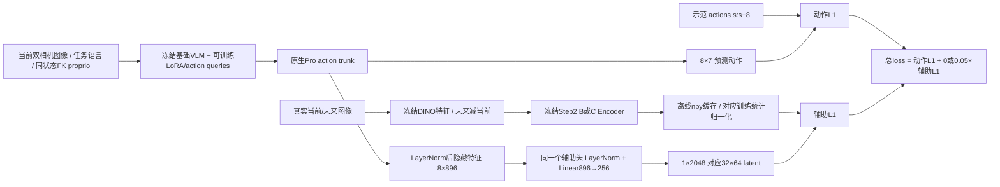

# Step 5.9 实际执行代码审查

路径下文使用占位符：`VLA_WORKTREE` 为已验收独立 VLA worktree；`EXP` 为本研究实验根目录；`RLA_ROOT` 为官方 RLA checkout。源码SHA和实际路径保存在本地 source/protection inventory；分享版本使用相对路径。

实际入口是 `VLA_WORKTREE/run_math_step57.sh:20` → `train_math_step57.py:10`，后者只执行 `validate_step0.py` 在 `grads={};i=selected[0]` 之前的初始化、真实数据加载和公平性检查。不是旧 SparseHead trainer。Git HEAD为 `23fa0c9c159e2aa04341cdd3e924f44061311060`；实验脚本是未跟踪的新文件，所以HEAD单独不足以复现，必须同时保留源文件SHA和快照。

## 六个关键问题的源码证据

| 问题 | 实际实现与位置 |
|---|---|
| 辅助分支是否显式输入动作？ | 没有独立动作输入。`causal_unified.py:39` hook 捕获 native `layer_norm2` 输出，`:44` 调用 native action head，再在`:48`预测辅助latent。该隐藏特征与动作输出共享，但不是预测动作向量或示范动作序列。 |
| 示范动作进入哪里？ | `vla-scripts/finetune.py:331`取`batch[actions]`，`:418`与预测动作算mean L1。`:337`模型前向没有示范动作张量；模型的动作token输入在`prismatic/extern/hf/modeling_prismatic.py:621`、`:629`替换成learned action queries。标签还用于定位动作token，但原生forward关闭语言CE。 |
| 有物理变化标签/loss吗？ | 当前目标函数`causal_unified.py:54`仅动作L1与latent辅助L1。没有物体位置、夹爪开合变化、关节变化loss。当前FK proprio是输入状态，不能当作未来物理后果监督。 |
| 有动作条件前向预测器吗？ | 本策略路径没有。不存在`(当前观测,实际动作序列)→未来latent`调用。项目历史RLA-WM与本轮策略训练入口不相连。 |
| C/D target生成与归一化？ | `EXP/step4_5_3.../extract.py`复用`EXP/step4_5_feature_target_pilot/run_20261021_02/extract.py:77`严格加载Encoder，`:82`执行`z,_=model(f_future-f_current)`，`:85`保存numpy。C用Step2 B Encoder，D用Step2 C Encoder。`validate_step0.py:51`读取对应npy和`normalization_B/C.npz`，`:54`减对应mean除对应scale，完整2048维。 |
| 未来是否只进入监督端？ | `validate_step0.py:39` loader在`:42`跳过`rla`；`:58` forward仅当前图像、语言、FK；`target_for`只由`objective`消费。离线numpy本身无梯度，target tensor为`requires_grad=False`；不是通过detach预测分支阻断学习。Step5.7预检及本轮冻结推理均未将未来图像/状态输入policy。 |

## 训练、部署和数据处理

- `causal_unified.py:63`仅VLM LoRA/action_queries可训练；native action head整个模块与proprio projector均可训练。辅助头在三组保留，B权重0。`:119`每次更新两个microbatch，各2样本，loss各除2累积；`:130`成功optimizer step后计数。
- 实际 batch来源为 `EXP/step4_5_3.../batches.py:6`读取Step4.5.2构造逻辑；`step4_5_2.../validate.py:91`使用`state[s:s+8]`的FK、`actions[s:s+8]`，在`:104`执行原libero标准化、归一化，在`:107`chunk；`:111`将顶点在左上的重渲染RGB水平翻转。Step5.1.1修复的是任务语言，图像/动作/FK/target不变。
- `prismatic/vla/datasets/rlds/oxe/transforms.py:827`：夹爪由原始−1开/+1闭转换为0闭/1开。`rlds/utils/data_utils.py:67`：BOUNDS_Q99及裁剪。`modeling_prismatic.py:786`：反归一化，无额外输出clamp。`experiments/robot/robot_utils.py:151`及`:182`将夹爪转换并翻转为环境约定。
- `rollout_step58.py:infer`使用同样当前双相机、FK归一化、任务语言；chunk8全部执行后重规划。使用Math SDPA、eval/inference mode；没有辅助target前向输入。每个trial完整reset并核对1e-8历史geometry。成功来自`env.check_success()`。
- 原生 `prismatic/models/action_heads.py:69`在phase=Training加入每次新建的Normal(0,0.02)扰动，Inference不加。该临时Parameter不属于持久module，optimizer不会更新它；扰动仍影响训练梯度。这是上游设计差异，本轮没有证据证明它导致退化。
- Pro动作属于OSC_POSE的归一化增量命令；控制器`control_delta=true`，世界坐标位置增量、旋转增量按轴角构造，内部缩放到每控制步位置0.05m、旋转0.5rad的范围。不是绝对末端位置target。动作维度与物理位移标签须区别。

## 解释范围

Step0的原生/wrapper一致性与B/C/D公平性已有记录；本轮另比较固定真实输入通过训练前向和部署`predict_action`的输出，并保存逐checkpoint动作偏移。即便发现路径差异，也必须区分上游设计、共同偏移与导致微调退化的因果证据。没有新增rollout用于验证解释。
